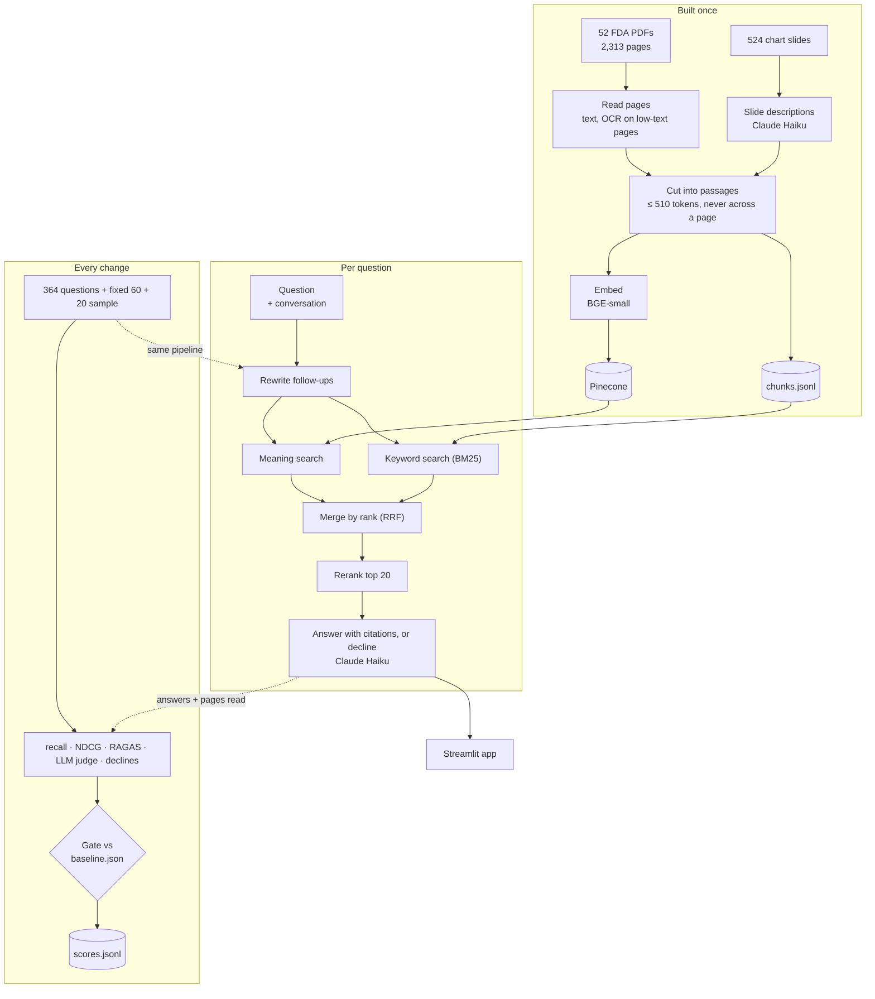

# Multimodal RAG Engine

Ask a question about 52 FDA documents (slide decks full of charts, plus two regulatory books) and get an answer that cites the exact PDF and page it came from. If the documents don't contain the answer, the system says so instead of guessing.

Built with Claude Haiku 5.5 for answers and for reading chart slides, BGE embeddings in Pinecone plus keyword search for retrieval, a cross-encoder reranker, RAGAS and an LLM judge for scoring, and a Streamlit app in Docker.

---

## Live Demo

**[https://huggingface.co/spaces/raguram3398/Multimodal-RAG-Engine](https://huggingface.co/spaces/raguram3398/Multimodal-RAG-Engine)**

Paste your own Anthropic API key from [console.anthropic.com](https://console.anthropic.com) in the sidebar. It is kept only for your browser session and is not saved anywhere. Each answer costs about $0.001 on your key, plus about $0.002–0.003 for its live quality scores. The Space runs on Hugging Face's free 2-CPU hardware and sleeps when idle, so the first visit wakes it up.

The same image also runs on AWS (EC2 behind CloudFront, see [Deploy (AWS)](#deploy-aws)). That instance is stopped between sessions, so the Space is the link that is always up.

---

## Architecture



Switches for the measured options (environment variables): `REWRITE`, `HYDE`, `RETRIEVAL=vector|hybrid`, `RERANK`, `SELF_CHECK`. The defaults are the kept system: hybrid search, reranker on, the rest off.

---

## What It Does

- **Finds the right pages, including charts.** 524 slides are mostly pictures with little text. Claude described each one (title, every number with its label), so a question about a bar chart can find that chart.
- **Answers with citations it can prove.** Every citation names the PDF and page. A citation is kept only if its quoted text matches the source passage exactly.
- **Declines when the answer isn't there.** On 20 trick questions whose answers are not in the documents, it declined all 20, in every one of the last 6 test runs.

---

## Results

The fixed baseline: the final system run 5 times, unchanged, on an M3 MacBook Air (2026-10-19). Every future change is measured against these numbers.

| Score | In plain words | Baseline (5-run average) |
|---|---|---|
| recall@10 | Of the pages that hold the answer, the share found in the top 10 | **0.635** (same in every run) |
| NDCG@10 | Like recall, but gives more credit for ranking the right page higher | **0.605** (same in every run) |
| Faithfulness (RAGAS) | Share of the answer's claims that the retrieved pages support | **0.918** (0.912–0.925) |
| Answer relevancy (RAGAS) | Whether the answer addresses the question that was asked | **0.829** (0.820–0.842) |
| Context precision (RAGAS) | Share of the retrieved pages that were actually useful | **0.606** |
| Context recall (RAGAS) | Share of the reference answer's facts found in the retrieved pages | **0.664** |
| LLM judge, 1–5 (faithfulness / relevance / completeness) | Claude grades each answer against a reference answer | **3.67 / 3.42 / 2.94** |
| Trick questions declined | 20 questions with no answer in the documents | **20 / 20** |
| Real questions answered | 60 questions that do have an answer | **49.6 / 60** (48–51) |

| Cost and speed | Value |
|---|---|
| Claude cost per question | about $0.001 |
| One full evaluation run (80 questions, all scoring) | about $0.56 |
| Search time on an M3 | 0.4 s (median) |
| Answer on screen, live demo (free 2-CPU Space) | 3.8–4.9 s |
| First answer after the Space restarts (models load once) | 9.7 s |
| Live quality scores (RAGAS) after the answer | about 15 s (measured before deployment, on 2 CPUs) |
| Answer on screen, AWS (t3.small via CloudFront, phone on cellular, stopwatch) | 6.7 s; first answer after the container starts 14.7 s (one sample each) |
| AWS instance start to app healthy through CloudFront | ≤ 78 s (one stop/start; upper bound) |
| Peak container memory on AWS, after answering | 1006 MiB of 1.87 GiB after 3 questions; 896 MiB after 1 (cgroup `memory.peak`) |
| AWS rollback to the previous image (already on disk), command to healthy via CloudFront | 7 s (one sample) |

---

## How It Was Built and Scored, Step by Step

Every change was measured on the same test set before it was kept:

- **Retrieval test (free, no Claude calls):** 364 real questions from the dataset, each with an answer key of the pages that hold the answer.
- **Full test (about $0.5 per run):** a fixed sample of 60 real questions and 20 trick questions, chosen once and never used for tuning. Claude answers all 80; RAGAS and an LLM judge score the answers; the system counts how many real questions it answered and how many trick questions it declined.
- **The gate:** a change is kept only if no score drops by more than its allowed threshold. Trick-question declines may never drop.

| Step | Change | Pages found (recall@10) | Faithfulness | Answer relevancy | Real answered / 60 | Trick declined / 20 | Decision |
|---|---|---|---|---|---|---|---|
| 1 | Search by meaning, first full evaluation | 0.557 | 0.925 | 0.868 | 45 | 20 | Starting point |
| 2 | Claude describes 524 chart slides | 0.579 | 0.919 | 0.833 | 49 | 20 | **Kept** |
| 3 | Claude rewrites questions before search | no gain | – | – | – | – | Off |
| 4 | Keyword search added to meaning search | 0.620 | 0.926 | 0.844 | 51 | 20 | **Kept** |
| 5 | Reranker re-orders the top 20 | 0.635 | 0.889 | 0.822 | 50 | **19** | Rejected by the gate |
| 5b | One prompt rule for wrong version or year, reranker again | 0.635 | 0.903 | 0.832 | 51 | 20 | **Kept** |
| 6 | Claude checks its own answer and retries | 0.635 | 0.919 | 0.844 | 50 | 20 | Passed, but off |
| 7 | Web app in Docker | – | – | – | – | – | Built |
| 8 | Fixed baseline: final system run 5 times | 0.635 | 0.918 | 0.829 | 49.6 | 20 | Reference for all future runs |

Rows 1–6 are single runs on the same Mac. Step 8 measured how much a single run moves by luck: up to 0.013 on faithfulness and 0.021 on answer relevancy.

### 1. Reading the documents and the first search

The 52 PDFs have 2,313 pages. Pages with almost no text (165) were read with OCR. Pages were cut into 4,183 passages of at most 510 tokens (the embedding model's limit), and no passage crosses a page, so every citation points to one page. Each passage was embedded with BGE-small and stored in Pinecone. For a question, the 10 closest passages go to Claude, which answers with citations turned on.

The evaluation was built in the same stage, and tested by breaking the system on purpose. With the wrong embedding model, pages found fell from 0.56 to 0.23 and no error was raised; the retrieval score caught it.

### 2. Teaching it to read charts

524 slides are mostly charts and images, so their extracted text is loose numbers ("19 25 13 FY 15 FY 16") with no labels. Claude described each slide at a one-time cost of $0.18, and the descriptions were added to the search index. Citations from them are labeled "AI description of the slide". Chart pages found rose from 0.40 to 0.44, and real questions answered from 45 to 48.

The same step removed a similarity-score cutoff that declined questions before Claude saw them. It caught 1 of the 20 trick questions and wrongly blocked 2 real ones, while Claude declined all 20 on its own. Without it: 49 of 60 answered, 20 of 20 trick questions still declined.

### 3. Rewriting questions (tested, turned off)

Two ideas were tested: Claude rewrites every question before search, or Claude writes a short imagined answer passage and the search looks for passages like it (HyDE). Neither beat the plain search on the 304 questions outside the test sample, and HyDE made results vary from run to run, so both are off. One part stayed: in a conversation, a follow-up like "How did that change after GDUFA?" is still rewritten into a standalone question. The first rewrite prompt slipped in facts Claude already knew, which would steer the answer; a stricter prompt with a forced structured output fixed it (0 leaked facts in 30 rewrites).

### 4. Keyword search plus meaning search (kept)

Meaning search misses exact rare terms: a chart whose only matching word is "FY12", or a slide that says "RWE". Keyword search (BM25) over all passages was added, and the two result lists are merged by rank (Reciprocal Rank Fusion). The default keyword settings gave words like "the" more weight than "drug"; setting the floor to zero fixed it. Pages found rose from 0.579 to 0.620, and real questions answered from 49 to 51, with no score lower.

### 5. Reranker (rejected, then fixed and kept)

A cross-encoder model re-reads the top 20 passages next to the question and re-orders them. Retrieval improved: pages found 0.620 to 0.635, and the right page ranked first on 193 of 304 held-out questions instead of 166.

On the Mac run it answered one trick question. The question asks about a fee under GDUFA III; the documents only cover GDUFA II. With more matching slides in front of it, Claude answered "one-third, but under GDUFA II", which counts as an answer. The gate failed, as designed.

Instead of re-running until it passed, one sentence was added to the prompt: if the question asks about a version, year or period the documents don't cover, the documents don't contain the answer. The acceptance rules were written before the runs: first the rule alone, then the rule with the reranker. Both passed, with 20 of 20 trick questions declined, so the reranker is on. The limit, stated before the runs: the only evidence the rule works comes from that one trick question.

### 6. Self-check and retry (tested, turned off)

After each answer, Claude scores it 1–10 against the passages it used. Below 6, the system searches again and re-answers once. It passed the gate, but on the 10 retried questions faithfulness fell from 0.906 to 0.811: most retries found the same pages, so the second answer was just another draw. It also adds 1.4–2.4 seconds to every answer. It's off; the code and the switch are kept.

### 7. The app

A Streamlit page where a visitor pastes their own Anthropic key (kept only in that browser session, never stored). Each answer shows its citations, the pages Claude read with their reranker scores, the cost and the time taken, then two quality scores computed live with RAGAS. It runs in Docker on a free Hugging Face Space; only the Pinecone key enters the container, as a Space secret. On the Space, answers appear in 3.8–4.9 s and cost $0.0007–0.0009; the first answer after a restart takes 9.7 s.

### 8. A fixed baseline for the gate

Until this step, each run was compared to the last run that passed. Small drops that each passed added up: answer relevancy went 0.868 → 0.848 → 0.833 → 0.832, and faithfulness 0.926 → 0.903, without the gate ever failing.

The fix: the final system was run 5 times, unchanged, on the Mac, and the averages were saved as a fixed file (`data/baseline.json`). Every future run is compared to that file. Each score's threshold is the larger of 0.05 and its measured spread across the 5 runs. Retrieval scores were identical in all 5 runs, so their threshold is 0.005. The file also records a fingerprint of the code and data, and the models and package versions behind it.

What it showed: luck moves these scores less than the earlier history suggested (answer relevancy varied by 0.021, not 0.08). A sixth run, compared to the new file, passed. Cost of the baseline: $3.35.

---

## Project Structure

```
multimodal-rag-engine/
├── pyproject.toml, uv.lock
├── Dockerfile, docker-compose.yml, requirements-app.txt
├── streamlit_app.py            # the web app
├── deploy/
│   ├── deploy.sh               # on EC2: pull one image by commit SHA, replace the container
│   ├── ec2-trust.json          # lets EC2 assume the instance role
│   ├── ec2-role-policy.json    # the role: pull one ECR repo, read one SSM parameter
│   └── github-ecr-push-policy.json  # CI user: push to one ECR repo
├── src/multimodal_rag/
│   ├── config.py               # constants: paths, models, index name, thresholds, prices
│   ├── contracts.py            # data types passed between stages
│   ├── ingest.py               # PDFs → pages → passages → Pinecone
│   ├── vision.py               # chart slide → Claude description
│   ├── retrieve.py             # meaning + keyword search, merge, rerank, rewrites
│   ├── answer.py               # Claude answer, citation check, decline, cost, self-check
│   └── evaluate.py             # metrics, RAGAS, judge, gate, baseline, score log
├── data/
│   ├── chunks.jsonl            # all passages
│   ├── vision.jsonl            # the 524 slide descriptions
│   ├── baseline.json           # fixed reference scores for the gate
│   ├── scores.jsonl            # every full evaluation run
│   └── eval/                   # trick questions, the fixed sample, follow-up conversations
└── tests/                      # 63 tests
```

---

## Running It

Requires Python 3.12, [uv](https://docs.astral.sh/uv/), and tesseract + poppler for OCR. Put `ANTHROPIC_API_KEY` and `PINECONE_API_KEY` in `.env`. The dataset, [ViDoRe V3 Pharmaceuticals](https://huggingface.co/datasets/vidore/vidore_v3_pharmaceuticals), goes in `datasets/vidore_fda/` (not committed).

```bash
uv sync
uv run python -m multimodal_rag.ingest                    # build the index (~6.5 min on an M3, $0)
uv run python -m multimodal_rag.answer "your question"    # ask one question
uv run python -m multimodal_rag.evaluate                  # retrieval test (free, ~1 min)
uv run python -m multimodal_rag.evaluate full "label"     # full test, gated (~$0.56)
```

**App:** `docker compose up --build`, open http://localhost:7860 and paste an Anthropic key in the sidebar. Only `PINECONE_API_KEY` is passed into the container; every Claude call uses the visitor's key.

**Deploy (Hugging Face Space):** the Space holds only what the image needs: `Dockerfile`, `requirements-app.txt`, `streamlit_app.py`, the query-path code in `src/multimodal_rag/` and `data/chunks.jsonl`, plus this README with the Space header. `PINECONE_API_KEY` is a Space secret. Files go up with `hf upload <space> . --repo-type=space --delete="*"`, and HF rebuilds the image. Rollback: upload the files of the last good commit again, or revert in the Space's history. The app writes nothing, so there is no data to roll back.

**Tests:** `uv run pytest`. 63 tests cover passage limits and page boundaries, 0-indexed pages, citation checking, declines and refusals, search merging and reranking, the metrics, the gate and the baseline.

---

## Deploy (AWS)

```
push to main ──► GitHub Actions
                   check: ruff, black --check, pytest
                   image (only after check passes, only on main):
                     docker build (amd64) ──► ECR multimodal-rag-engine:<commit SHA>
Mac ──ssh──► EC2 t3.small: ./deploy.sh <SHA>
               pull that image, read the Pinecone key from SSM, replace the container
visitor ──HTTPS──► CloudFront ──HTTP :7860──► EC2 (Elastic IP; port open only to CloudFront's IP ranges)
```

- **Build:** CI pushes as the IAM user `github-ecr-push`, whose policy (`deploy/github-ecr-push-policy.json`) can push to this one repository and nothing else. Its access key is stored only in GitHub Actions secrets. Image tags are the commit SHA and are immutable, so re-running the image job for a SHA already in ECR fails at the push. That is expected.
- **Deploy:** manual, so the instance can stay stopped between sessions: SSH in and run `./deploy.sh <full SHA>`. The instance role (`deploy/ec2-role-policy.json`) can pull from this repository and read one SSM parameter. The Pinecone key is read at deploy time, so changing it in SSM needs a redeploy.
- **Blast radius:** a bad image breaks the AWS copy only; the Hugging Face Space is separate. The app only reads from Pinecone. A deploy has a few seconds of downtime while the container is replaced. A leaked push key can add new images to ECR but cannot overwrite or delete existing tags, and nothing runs until a SHA is deployed by hand.
- **Rollback, code:** `./deploy.sh <previous SHA>`. The previous image is usually still on the instance's disk, so the pull only checks the manifest and downloads nothing. ECR and the instance keep at least the last two images.
- **Rollback drill:** deployed the first CI-built image (`61257fc`), then rolled back to `5ea286b`, timed from the command to CloudFront's health check answering `ok`: 7 s (one sample; target under 5 minutes). Steps: (1) from the Mac, `ssh -i <key> ec2-user@<Elastic IP> './deploy.sh <previous SHA>'`; (2) poll `https://<distribution>/_stcore/health` until it answers `ok`; (3) ask one question and check the answer has citations. The first question after the swap still loads the models (about 15 s). Both images run the same app code (the newer commit changed only CI, `deploy/` and this README), so the drill proves the procedure, not a fix.
- **Rollback, data:** none. A deploy never writes to Pinecone or to `data/`. A change that needs new embeddings (new model or chunking) would need a new Pinecone index and its own rollback plan.
- **Cost:** EC2 t3.small $0.0208/hour while running, Elastic IP $0.005/hour always, ECR $0.10/GB-month above 500 MB (each image is about 0.75 GB), CloudFront within the free tier. The instance is stopped at the end of every session.

---

## What I Did Not Build and Why

| Not built | Why |
|---|---|
| Uploading your own documents | Needs OCR, parsing and embedding per visitor on free hardware, plus privacy handling, and the evaluation would not cover unknown documents |
| Live context precision / recall in the app | They need a reference answer, which a visitor's question doesn't have |
| Response cache, budget code | Visitors pay for their own Claude calls; a 20-question limit per session protects the free Pinecone tier |
| Read-only Pinecone key | Custom key permissions need a paid Pinecone plan. The app code never writes to the index, but the key it uses could |

---

## Known Limitations

- **The biggest remaining failure is declining real questions.** About 10 of 60 real questions get "not in the documents", sometimes with the right page already retrieved. The self-check can't help, because a decline is final.
- **Image slides are the hardest content.** Pages found on image slides (0.449) trail charts (0.536) and the overall average (0.635).
- **The version/year rule is backed by one test question.** It may also decline too eagerly: once, a follow-up that named one year and asked about later ones was declined.
- **Answer relevancy is lower than at the start** (0.868 in step 1, 0.829 in the baseline). Claude often opens with a hedge about what the documents say, which RAGAS scores as noncommittal.
- **The gate's 0.05 minimum is wide for faithfulness and answer relevancy.** It is 4–6 times their measured run-to-run variation, so a real drop of 0.03 would pass.
- **The test sample is small:** 60 real and 20 trick questions, from one dataset.
- **The AWS copy's CloudFront → EC2 hop is plain HTTP.** The visitor's Anthropic key is encrypted only from the browser to CloudFront; encrypting the last hop needs a domain and a certificate on the instance. The instance's app port is open to CloudFront's managed prefix list, which admits any CloudFront distribution, not only this one.

---

## Data and Credit

Dataset: ViDoRe V3 Pharmaceuticals (`vidore/vidore_v3_pharmaceuticals`), CC BY 4.0: 2,313 pages, 364 English questions with graded page labels. The 20 trick questions are hand-written. Answers are not medical or regulatory advice.
